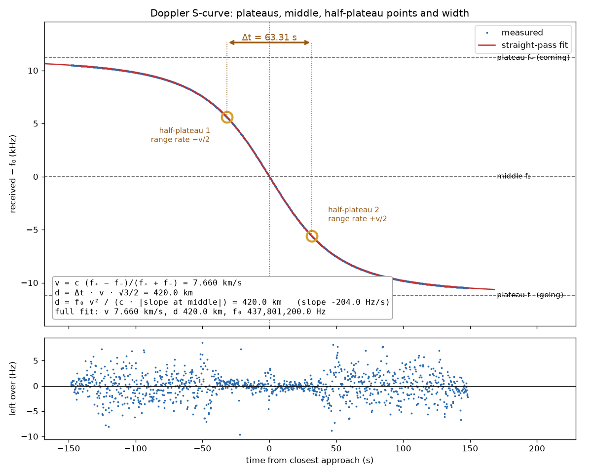
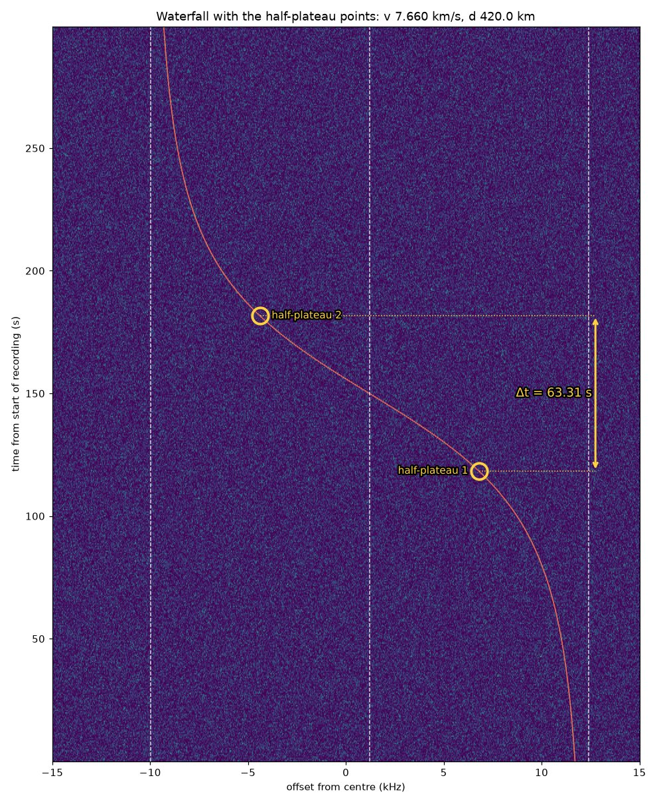
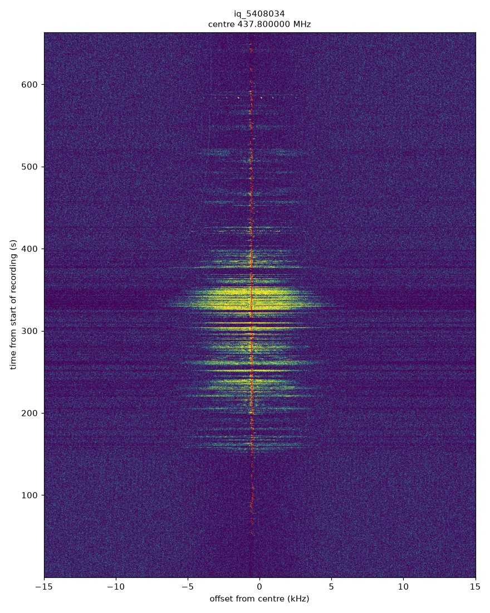
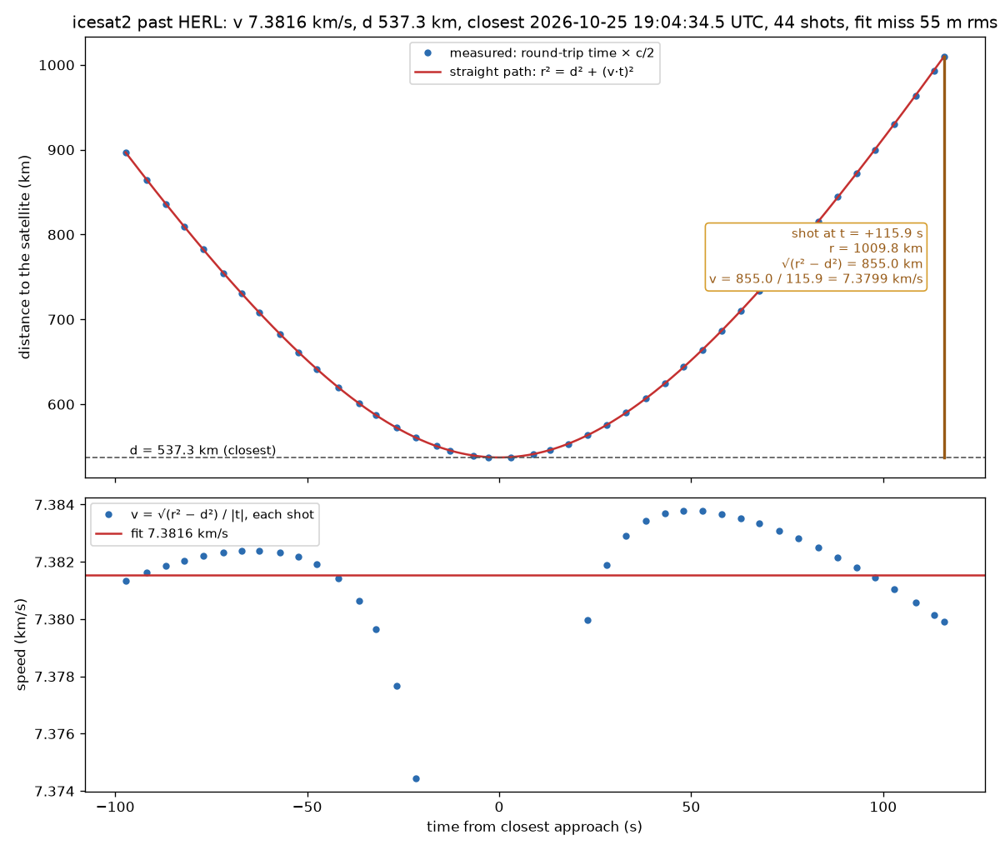

# Doppler kit

Measure a passing transmitter's speed and closest distance from your own radio or sound recording.
Only the frequency shift you receive is used. No station position, no orbit and no map are needed.
The kit also reads satellite laser ranging, where the distances themselves are measured.

From one recording you get:

- **v**: the speed of the source along its path.
- **d**: the closest distance between you and the source. When the pass goes straight over you, d is its height.
  From several passes, the smallest d comes closest to the height.
- **t₀**: the time of closest approach.
- **f₀**: the frequency the source actually transmits.
- **Path**: whether the source went past in a straight line or on a bending path.
- The distance at the first and last point of the trace.
- Pictures of the S-curve and the waterfall, with the plateaus, the middle, the two half-plateau points and the width Δt marked where they fall.

## What you need

- Python 3 with numpy, scipy and matplotlib: `pip install numpy scipy matplotlib`. Tkinter for the window (included with Python on Windows and macOS; `python3-tk` or `tk` on Linux). ffmpeg for compressed audio.
- A recording made at a **fixed frequency with Doppler correction off**, through the whole pass if you can:
    - a WAV file with 2 channels (I and Q), 8-bit, 16-bit or 32-bit float, such as an SDR++ "baseband" recording,
    - a headerless raw IQ file (`.raw`, `.cs16`, `.cf32`, `.cu8`, `.sigmf-data`) with its sample rate, or
    - audio: a 1-channel WAV, `.ogg`, `.mp3`, `.flac`, `.m4a` or `.opus`. This can be a receiver's audio output in USB or CW mode,
      or a plain sound recording of a passing source (a horn, an engine, a siren). The strongest tone is tracked.
- The centre frequency of the recording. SDR++ puts it in the file name (`baseband_437800000Hz_...`).
  For receiver audio, the dial frequency (USB). For a sound recording, leave it blank.
- Or a laser-ranging file: see Laser ranging below.

A cheap RTL-SDR and a simple antenna are enough for the ISS (437.800 MHz FM repeater, 145.800 MHz voice).

## Run

The window:

```
python3 doppler_gui.py
```

Pick the recording, fill in the centre frequency if the file name does not hold it, and press Run.
The tabs show the waterfall, the S-curve and the marked waterfall. The Results tab lists every number:
v, d, t₀, f₀, the plateaus, the half-plateau points and Δt, the three ways to v and d, the path test and the distances.
For a sound recording choose "sound in air (343 m/s)".

From the command line:

```
python3 iq_to_trace.py my_recording.wav
python3 fit_pass.py my_recording_trace.csv
```

Other inputs:

```
python3 iq_to_trace.py my_recording.wav --center 145800000 --start 2026-06-14T18:10:09Z
python3 iq_to_trace.py iq_5408034.raw --rate 48000 --center 437800000            # raw 16-bit IQ
python3 iq_to_trace.py capture.cf32 --rate 250000 --center 437800000 --format cf32
python3 iq_to_trace.py beacon_usb.ogg --center 145796000                         # receiver audio, dial frequency
python3 iq_to_trace.py horn.wav && python3 fit_pass.py horn_trace.csv --c 343   # sound
```

Options: `--span` (search ± Hz around the centre, default 15000), `--swap-iq` (Q stored before I), `--out` (output folder).
For the fit: `--c` (wave speed, default radio and light; 343 for sound) and `--f0` (fix the transmitted frequency).
`fit_pass.py` also takes a trace from anywhere else: a CSV with columns `t_s` and `f_Hz`.

## Output

`iq_to_trace.py`

| File | Content |
|---|---|
| `<name>_trace.csv` | `t_s, utc, f_offset_Hz, f_Hz, snr_dB`: received frequency against time |
| `<name>_waterfall.png` | 0.1 s spectra, frequency across and time up the page, with the measured trace in red |
| `<name>_waterfall.npz` | the waterfall data, used for the marked waterfall |
| `<name>_summary.json` | settings, number of points, point noise, the frequency swing, fixed receiver lines found |

`fit_pass.py`

| File | Content |
|---|---|
| `<name>_fit.json` | v, d, t₀, f₀ with errors (full fit), the plateau estimate, the marks, the path test, the distances at the first and last point |
| `<name>_scurve.png` | the S-curve with plateaus f₊ and f₋, middle f₀, half-plateau points, Δt, and the numbers worked from them; below it, what the fit leaves over |
| `<name>_waterfall_marked.png` | the waterfall with the fitted curve, f₊, f₀, f₋, the half-plateau points and Δt marked |

## Check that it works

```
python3 make_test_iq.py
```

It writes a 300 s synthetic recording of a known pass (7.660 km/s, 420 km), runs both scripts, compares the answer
and deletes the recording. It also checks `slr_fit.py` on a synthetic laser pass. It ends with `self-check passed`. These are its pictures:





## Doppler-corrected recordings do not work

Many receivers, SatNOGS stations among them, retune along the Doppler predicted from the published orbit while they record.
Their recordings hold only what is left over after that prediction, a nearly straight line instead of an S.
`iq_to_trace.py` prints a note when the signal moves less than a fifth of the search span.

Example: SatNOGS observation 5408034, the ISS at 437.800 MHz on 3 February 2022, recorded by the Dwingeloo radio telescope.
The ISS carrier stays within about 270 Hz for the whole pass. A pass recorded at a fixed tuning moves about ±10 kHz.



Data: CAMRAS, Dwingeloo radio telescope, SatNOGS IQ data, CC BY 4.0, https://data.camras.nl/satnogs/

## How it works

**The trace** (`iq_to_trace.py`)

1. Decimate to about 48,000 samples a second with a polyphase filter, and remove the receiver's DC line.
2. Find the signal: 0.25 s spectra, every bin and every frame divided by its median, fixed receiver lines masked,
   strongest 300 Hz band per frame. A smooth S-shaped curve through it steers the next steps only.
3. Measure: multiply the recording by the conjugate phase of that curve (dechirp), so the carrier sits near 0 Hz.
   Then 1.0 s Hann windows every 0.25 s on a 1 Hz grid, searching ±400 Hz, then ±100 Hz, then ±150 Hz,
   each time with a better reference. The value is the noise-subtracted power centroid in the band.
4. Keep a point when its peak is more than 14 dB above the frame median, it is not on a fixed receiver line,
   and it lies within 4 sigma of a smoothing spline. Sigma (the point noise) comes from second differences.

Points are 0.25 s apart but each uses a 1 s window, so only every 4th point is independent. `fit_pass.py` allows for this in its errors.

**The fit** (`fit_pass.py`)

A source moving in a straight line at constant speed v, closest distance d at time t₀, transmitting f₀.
With the travel time of the signal included, the received frequency is

    f(t) = f₀ / (1 + v² τ / (c √(d² + v² τ²)))

where τ is the emission time from closest approach. Read off the curve:

- **Plateaus** f₊ = f₀/(1 − v/c) coming and f₋ = f₀/(1 + v/c) going, so v = c (f₊ − f₋)/(f₊ + f₋) and f₀ = 2 f₊ f₋/(f₊ + f₋).
- **Half-plateau points**: where the distance changes at half the speed (±v/2), f = f₀/(1 ∓ v/2c).
  The time between them is Δt, and d = Δt · v · √3/2.
- **Slope at the middle**: d = f₀ v² / (c · |slope|).
- **Full fit**: least squares of the whole curve, free t₀, v, d and f₀. This is the result to use. A pass cut short by
  the horizon never reaches its plateaus, so the plateau estimate alone reads v and d low.

What the fit leaves over shows the path: a straight path leaves scatter around zero, a bending path leaves a smooth wave.
`fit_pass.py` fits a degree-6 polynomial through the leftover and compares it with the scatter (F-test, counting only independent points).
When the smooth part stands out (p below 0.001) the path is reported as bending, otherwise as straight.

## Laser ranging

Laser stations fire short pulses at a satellite and time each return. Each shot gives a distance directly:

    r = round-trip time × c / 2

A satellite flying straight past the station at speed v, closest distance d at time t₀, is at

    r² = d² + (v · t)²        (Pythagoras, t from closest approach)

so every shot gives the speed on its own:

    v = √(r² − d²) / |t|

`slr_fit.py` fits d, v and t₀ to all shots within ±3 minutes of the closest one.

```
python3 slr_fit.py https://edc.dgfi.tum.de/en/data/npt2/1166240/     # one pass, from its EDC page
python3 slr_fit.py icesat2_20261025.np2 --pass 3                     # a daily CRD file, plot pass 3
```

It writes `<name>_slr.csv` (v, d, closest time, shots and fit miss for every pass) and `<name>_pass<N>.png`.
The window takes `.np2`, `.npt` and `.crd` files too.

Example: ICESat-2 past Herstmonceux (UK) on 25 October 2026, 44 shots. The last shot, 115.9 s after closest approach,
is 1,009.8 km away: √(1,009.8² − 537.3²) = 855.0 km along the path, and 855.0 / 115.9 = 7.38 km/s.



Data: EUROLAS Data Center (EDC), DGFI-TUM, https://edc.dgfi.tum.de/


## Where to find recordings

Recordings made by others. Check each one for Doppler correction before you use it.

- CAMRAS Dwingeloo telescope, SatNOGS IQ data (Doppler-corrected): https://data.camras.nl/satnogs/
- Other SatNOGS stations sharing IQ, and the discussion of their format: [Long-term Raw I/Q data request (Libre Space)](https://community.libre.space/t/long-term-raw-i-q-data-request/14691)
- [BY70-2 satellite beacon recording (Zenodo)](https://zenodo.org/records/3941245), Linrad raw format
- [Artemis I EQUULEUS recording, Allen Telescope Array (Zenodo)](https://zenodo.org/record/7422673)
- [OSIRIS-REx recording, Allen Telescope Array (Zenodo)](https://zenodo.org/records/8418286)
- [LoRadar: raw IQ of satellite-to-ground LoRa signals (Zenodo)](https://zenodo.org/records/16302856)
- [IQEngine: browse and share IQ recordings (GitHub)](https://www.github.com/IQEngine/IQEngine), site at https://iqengine.org
- Laser ranging, every station and satellite, normal points in CRD format: [EUROLAS Data Center](https://edc.dgfi.tum.de/en/data/npt2/) and [NASA CDDIS](https://cddis.nasa.gov/Data_and_Derived_Products/SLR/Normal_point_data.html)

## Related

Doppler simulator and calculator: https://alanspaceaudits.github.io/theorema-egregium/doppler_sim/
