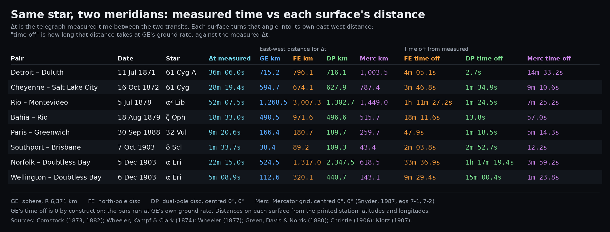

# Paired-station transits, 1871 to 1903

Sources for the video *Omnidirectional Distance Symmetry*: eight telegraphic longitude determinations in which the same star was timed across the meridians of two stations.

**Video:** [Omnidirectional_Distance_Symmetry_v1.mp4](https://github.com/AlanSpaceAudits/theorema-egregium/releases/download/transits-video-v1/Omnidirectional_Distance_Symmetry_v1.mp4) (release `transits-video-v1`, 11 min 20 s, 1080p)

## The eight pairs

| Pair | Date | Star | Δt (telegraph) | Δt cited | Star records cited |
|---|---|---|---|---|---|
| Detroit to Duluth | 11 Jul 1871 | 61 Cyg A | 36m 05.96s ± 0.05s | Comstock (1882) p. 718; Comstock (1873) p. 1057 | Comstock (1873) pp. 1060, 1064 |
| Cheyenne to Salt Lake City | 16 Oct 1872 | 61 Cyg | 28m 19.437s ± 0.017s | Wheeler, Kampf & Clark (1874) p. 29 | pp. 18, 24 |
| Rio de Janeiro to Montevideo | 5 Jul 1878 | α² Lib | 52m 07.53s | Green, Davis & Norris (1880) p. 65 | pp. 55, 56 |
| Bahia to Rio de Janeiro | 18 Aug 1879 | ζ Oph | 18m 33.00s | Green, Davis & Norris (1880) p. 65 | pp. 53, 54 |
| Paris to Greenwich | 30 Sep 1888 | 32 Vul | 9m 20.602s ± 0.018s | Christie (1906) pp. 103, 112 | pp. 67, 74 |
| Southport to Brisbane | 7 Oct 1903 | δ Scl | 1m 33.738s ± 0.047s | Klotz (1907) pp. 189, 197 | pp. 134, 152 |
| Norfolk Island to Doubtless Bay | 5 Dec 1903 | α Eri | 22m 15.000s ± 0.021s | Klotz (1907) pp. 190, 197 | pp. 155, 161 |
| Doubtless Bay to Wellington | 6 Dec 1903 | α Eri | 5m 08.941s ± 0.045s | Klotz (1907) pp. 191, 197 | pp. 161, 169 |

The telegraph timing segment of the video works through the night of 16 October 1872 from Wheeler, Kampf & Clark (1874) p. 29: signals sent each way between Cheyenne and Salt Lake City, both chronographs, the chronometer errors, and the mean of the two directions.

## Files

- `shots/`: page images of the cited passages, the cited lines marked in red or blue.
- `pdf/`: the source files. Comstock (1873) and Christie (1906) are excerpts of the cited pages; the full scans are at the URLs below.
- `citations.json`: one entry per source with its page images, captions and verbatim quotes (format in `../SCHEMA.md`).

## References

- Christie, W. H. M. (Dir.). (1906). Telegraphic determinations of longitude made in the years 1888 to 1902. Royal Observatory, Greenwich; His Majesty's Stationery Office (Neill & Co.). https://archive.org/details/telegraphicdeter00royarich
- Comstock, C. B. (1873). Annual report of Major C. B. Comstock, Corps of Engineers, for the fiscal year ending June 30, 1872: Survey of the northern and northwestern lakes (Appendix Z). In Executive documents printed by order of the House of Representatives, 1872-'73 (42nd Congress, 3rd session). Government Printing Office. https://archive.org/details/housedocumentso24housgoog
- Comstock, C. B. (1882). Report upon the primary triangulation of the United States Lake Survey (Professional Papers of the Corps of Engineers of the United States Army, No. 24). Government Printing Office. https://archive.org/details/cu31924004126904
- Green, F. M., Davis, C. H., & Norris, J. A. (1880). Telegraphic determination of longitudes on the east coast of South America. U.S. Hydrographic Office, Bureau of Navigation. https://archive.org/details/telegraphicdete00norrgoog
- Klotz, O. J. (1907). Transpacific longitudes between Canada and Australia and New Zealand, executed during the years 1903 and 1904. In Report of the Chief Astronomer, Department of the Interior, for the year ending 30th June 1905 (Appendix 3; Sessional Paper No. 25b). King's Printer. https://archive.org/details/transpacificlon00klotgoog
- Snyder, J. P. (1987). Map projections: A working manual (U.S. Geological Survey Professional Paper 1395). U.S. Government Printing Office. (Mercator grid, eqs 7-1, 7-2.)
- Wheeler, G. M., Kampf, F., & Clark, J. H. (1874). Report upon the determination of the astronomical co-ordinates of the primary stations at Cheyenne, Wyoming Territory, and Colorado Springs, Colorado Territory, made during the years 1872 and 1873. Government Printing Office. https://archive.org/details/reportupondeter00usgoog
